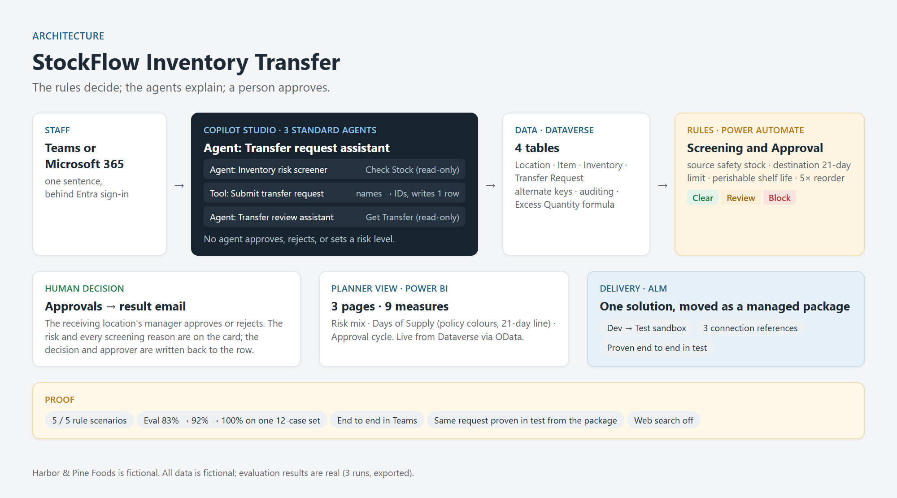

# StockFlow Inventory Transfer: Architecture

How a transfer request travels from one sentence to a recorded human decision, what each layer is allowed to do, and how the system moves between environments.

## Flow described in words

1. **Entry point.** A staff member types one sentence to the **Transfer request assistant** in Teams or Microsoft 365, behind **Microsoft Entra** sign-in. Only the Teams, Microsoft 365 and SharePoint channels are offered, because the agent uses Microsoft authentication.

2. **Advice before anything exists.** The assistant hands the proposal to the **Inventory risk screener**, a connected agent with one read-only tool, **Check Stock**. Check Stock looks up the item and both inventory rows and returns the figures. The screener applies the four policy checks and replies with each result, the numbers behind it, and a *likely* result (Clear, Review or Block), labelled as advisory. If a name misses, Check Stock returns NOT FOUND instead of failing, and both agents map everyday names ("olive oil") to the policy's exact names before calling any tool.

3. **Submission.** Once every detail is present and repeated back, the assistant calls **Submit transfer request**, an agent flow. Dataverse links rows by hidden IDs, so the flow turns the typed names into IDs (Find Item, Find From, Find To). A name that isn't on the list stops the flow with a plain reply and the valid options, and no row is written.

4. **Data.** **Dataverse**, four tables: Location, Item, Inventory, Transfer Request. Alternate keys on item and location names block duplicates. Auditing is on for the environment and the Transfer Request table. An **Excess Quantity** formula column (`Quantity > 5 × Item.Standard Reorder Quantity`) recalculates on its own. Need By Date is time-zone independent.

5. **Rules set the risk.** A new row triggers **StockFlow Screening and Approval** (Power Automate). It reads the item and the stock at both ends, runs the four checks, and writes **Risk Level** (Clear / Review / Block) and **Screening Notes** in plain language. These are fixed thresholds, not AI.

6. **A person decides.** The flow starts an approval and waits. The receiving location's manager sees the request, its risk and every reason in **Approvals**, and approves or rejects. The flow writes the status and the approver back to the row, then emails the requester the outcome with the reasons. Approvers must be accounts inside the tenant.

7. **The manager's agent.** The **Transfer review assistant** answers the approver's questions with one read-only tool, **Get Transfer**: current status first, the screening result quoted, recent requests to the same location. Every answer ends "Decision: yours, in Approvals. I don't approve or reject."

8. **The planner's view.** **Power BI**, three pages and nine measures, reading live from Dataverse through the OData feed: Risk mix, Days of Supply (coloured by the policy, with the 21-day line), and Approval cycle.

## Who can do what

| Component | Reads | Writes | Decides |
|---|---|---|---|
| Transfer request assistant | Policy, screener's advice | One new request (via Submit) | Nothing |
| Inventory risk screener | Stock (via Check Stock) | Nothing | Nothing (advice only) |
| Transfer review assistant | One request + recent ones (via Get Transfer) | Nothing | Nothing |
| Screening flow | Item, stock | Risk Level, Screening Notes, Status, Approver | The **risk level**, by fixed rules |
| Manager, in Approvals | The request, risk and reasons | Approve / reject | The **transfer** |

## Delivery: one solution, two environments

Everything above lives in one solution, **StockFlow transfers**: 4 tables, the canvas app, 4 flows, 3 agents and the design plan. It was exported as a **managed** package (1.0.0.1) and imported into a separate sandbox test environment.

- The flows reach their connections through **3 connection references** (Dataverse, Approvals, Office 365 Outlook), so the same package runs under different credentials in each environment.
- A solution carries the design, not the data. Test got its own reference data (6 locations, 5 items, 12 inventory rows) loaded separately.
- Managed means locked in test: changes are made in development and shipped forward as a new version.

## Choices made on purpose

- **Standard agents, not the GitHub Copilot harness.** The standard agents use no Copilot credits, run on the same licence as the earlier Clinic build, and come with a known governance surface (solution, Entra agent ID, DLP).
- **Web search off on all three agents** (`webBrowsing: false` in the export). Answers come from the Transfer Policy and the tools.
- **The screener is never published to a channel.** It is reachable only through the request assistant.
- **Author credentials, flagged.** The tools run with the author's credentials, which is fine in a one-person development tenant. Production would switch each tool to end-user credentials.

*All Harbor & Pine Foods data and scenarios are fictional, for demonstration only.*
