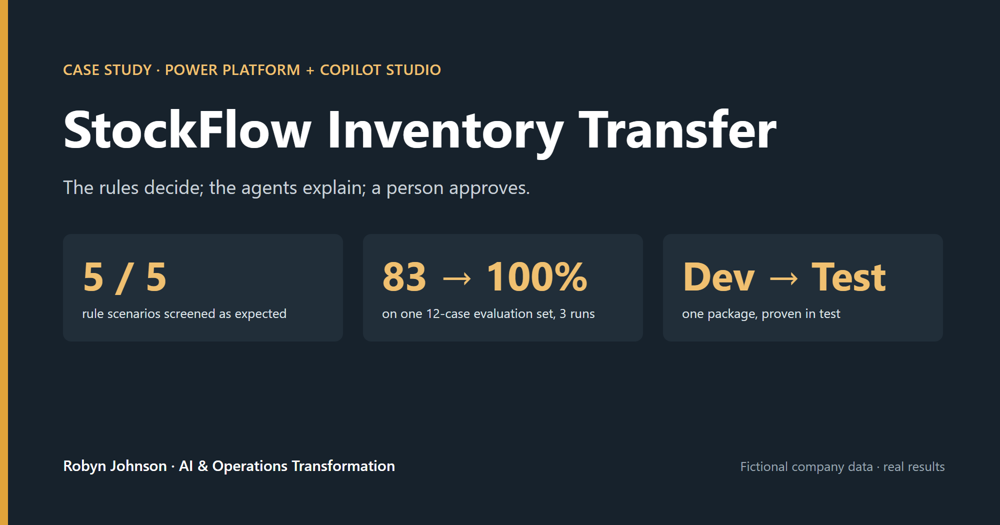
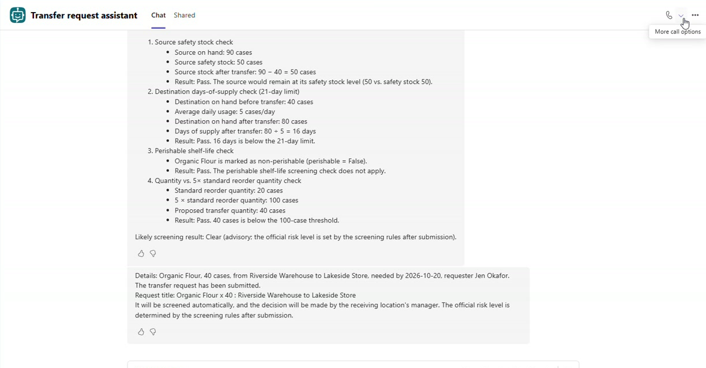

# StockFlow Inventory Transfer

> **Status:** ✅ built, evaluated (3 runs), used from Teams, and moved from development to a test environment as one managed package: September 30 to October 11, 2026

**One line:** A governed inventory-transfer system on the Microsoft Power Platform. Fixed supply-chain rules screen every request and write the reason down, three Copilot Studio agents explain and submit, and a person makes every decision. **The rules decide; the agents explain; a person approves.**

**▶ [Watch the 5-minute narrated walkthrough on YouTube](https://youtu.be/pbvypcWHsEI)** · [8-minute technical build video](https://youtu.be/tgZRtPVmWLo) · [44-second highlight](demo/stockflow-demo.mp4)

## The problem → the result
- **Problem:** Transfers between locations travel by email and spreadsheet. The dangerous request is the one that looks fine on a form: it drains the source below its safety stock, buries the destination in weeks of supply, or ships a perishable item that will spoil. A planner catches these by instinct; a form never does.
- **Result:** Every request is screened by four written checks and gets a risk level (Clear, Review or Block) with a plain-language note, then waits for the receiving location's manager. Staff ask in one sentence from Teams; an advisory agent shows the stock figures before anything is submitted; no agent can approve. **5 of 5 rule scenarios matched; the staff agent scored 83% → 92% → 100% on one 12-case test set; the whole system was moved to a test environment as one package and proven end to end there.**

## What makes this more than a form with a chatbot
| | |
|---|---|
| **Rules, not AI, set the risk** | Four fixed checks (source safety stock, destination 21-day limit, perishable shelf life, 5× reorder quantity) run in a flow on every request. The headline catch: 45 cases of flour that a form would approve, flagged Review because the source would drop to 45 against a safety stock of 50. |
| **Agents with defined limits** | A staff assistant that submits, a screener that only advises, and a manager's assistant that only summarizes. None can approve, reject or set a risk level, and the screener is never exposed to a channel. |
| **Measured, not demoed** | 12-case test set, three runs, all exported. The default grader failed two *correct refusals*; a custom grader fixed the measure; a wording flaw in that grader was found and corrected too. |
| **A chain tested as a chain** | The screener worked alone but crashed when "olive oil" crossed the agent handoff. Fixed with a null-safe lookup and exact-name mapping, then proven both ways (Clear and Block). |
| **Shipped like real software** | One solution, exported managed, imported into a sandbox test environment through connection references, data loaded separately, and the same request proven end to end in test. |

## Architecture

## Built with
Microsoft **Dataverse** (alternate keys, auditing, a Power Fx formula column) · **Power Automate** (screening rules, Approvals, Outlook) · **Copilot Studio** standard agents, GPT-5.5 Chat, agent flows, a connected agent, Evaluations with a custom grader · **Power Apps** canvas app · **Power BI** (OData, DAX, theme) · **Power Platform Plans** for the design · **solutions and ALM** (managed export, connection references, sandbox environment) · Teams / Microsoft 365 channel behind **Microsoft Entra** sign-in. **No custom code**: Power Fx, flow expressions and DAX only.

## Repository contents
| Path | What it is |
|---|---|
| [CASE_STUDY.md](CASE_STUDY.md) | The full story: problem, what I built, the two worked examples, measurement, problems solved, the move to test |
| [EVALUATION.md](EVALUATION.md) | The rule scenarios, the 12-case test set, all three runs, the custom grader verbatim |
| [ARCHITECTURE.md](ARCHITECTURE.md) | How it's wired, who can do what, and how it moves between environments |
| [AGENT_INSTRUCTIONS.md](AGENT_INSTRUCTIONS.md) | The three agents' instructions, exported verbatim from the solution |
| [PROBLEMS_SOLVED.md](PROBLEMS_SOLVED.md) | 21 real problems from the build: symptom, cause, fix and lesson |
| [SAMPLE_OUTPUTS.md](SAMPLE_OUTPUTS.md) | What the agents, rules, approval card and emails actually say, copied from real runs |
| [DASHBOARD.md](DASHBOARD.md) | The Power BI model, the nine measures, the colour rule, the numbers checked, and what they mean |
| `knowledge/` | The Transfer Policy the agents are grounded on (`.md` + the `.docx` uploaded) |
| `data/` | The fictional seed data, the test scenarios, and the lookup checklist |
| `eval/` | The test set and all three evaluation exports (CSV) |
| `screenshots/` | Figures from the build, the evaluation, Teams, Power BI and the test environment |
| [demo/](demo/README.md) | 5-minute narrated walkthrough, 8-minute technical build video, 44-second highlight, vertical cut |
| `CASE_STUDY.pdf` | The case study as a formatted PDF |

## How to reproduce
1. Create the four Dataverse tables from `data/` (Location → Item → Inventory), with alternate keys on Item Name and Location Name. Import Inventory from `3-Inventory-NO-LOOKUPS.xlsx` and set its two lookups in the grid using `data/LOOKUP-CHECKLIST.md`.
2. Build the screening flow on *When a row is added* to Transfer Request: look up the item and both inventory rows, apply the four checks in [EVALUATION.md](EVALUATION.md), write Risk Level and Screening Notes, then *Start and wait for an approval* and email the result. Verify with the five scenarios in `data/SCENARIOS.md`.
3. In Copilot Studio (standard agent, inside your solution), create the three agents from [AGENT_INSTRUCTIONS.md](AGENT_INSTRUCTIONS.md), upload `knowledge/Transfer-Policy.docx`, turn **web search off**, and add the three agent flows (Submit transfer request, Check Stock, Get Transfer). Connect the screener to the request assistant.
4. **Evaluation → import** `eval/test-set.csv`, add a custom test method with the Run 3 instructions from [EVALUATION.md](EVALUATION.md), and run.
5. To move it: add every flow to the solution, export **managed**, import into a second environment, set the connection references, load the reference data, turn the flows on, and publish the agents (screener first).

## Note
> **All data and scenarios are fictional, for demonstration only.** Harbor & Pine Foods does not exist; the locations, items, stock levels, people and policy are synthetic. **The evaluation results and every screenshot are real**, taken from the working system.
