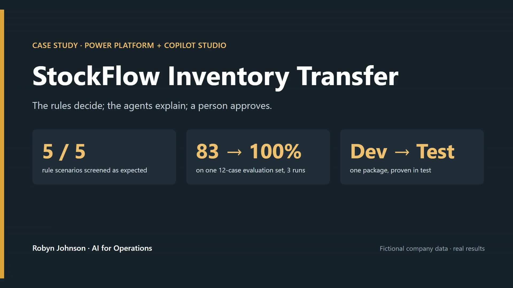

# Demo

**Technical build video (8:30, narrated):** [stockflow-technical.mp4](stockflow-technical.mp4). How it was built, in order: design in Power Platform Plans, the Dataverse model, the screening flow, the human approval step, the agents and their tools, the evaluation, Power BI, and shipping it as a managed solution. Every problem shown is real; see PROBLEMS_SOLVED.md.

**Full walkthrough (5:12, narrated):** [stockflow-walkthrough.mp4](stockflow-walkthrough.mp4). The problem, the rules, the chain in Teams, the refusal, the human approval, the evaluation, what broke, the Power BI view, and the move to a test environment. Narrated in Robyn's voice (ElevenLabs v4) from a script fact-checked against the case study.

A 44-second walkthrough of StockFlow, from one sentence in Teams to a decision recorded in a second environment:

- Staff, in Teams: one sentence; the screener checks live stock and shows every figure; the request is submitted
- The rules decide: 45 cases looks fine on a form, but the source would drop below its safety stock, so the result is Review with the reason written down
- Advice before anything exists: 200 cases of olive oil gets three failed checks with the figures, likely Block, and nothing is submitted
- A person approves: the manager sees the risk and the reason in Approvals; no agent can approve
- Evaluation: 83% → 92% → 100% on one 12-case test set
- Planner view: days of supply coloured by the 21-day policy
- Moved, not rebuilt: the same request in the test environment, from one managed package, ends Approved with Risk Clear

**Video:** [stockflow-demo.mp4](stockflow-demo.mp4) (16:9, 0:44, no audio) · [vertical cut](stockflow-demo-vertical.mp4) (9:16, 0:35)

*All Harbor & Pine Foods data on screen is fictional. Built Oct 11, 2026 from build recordings and screenshots (Oct 1 to Oct 11); account identifiers cropped out.*
